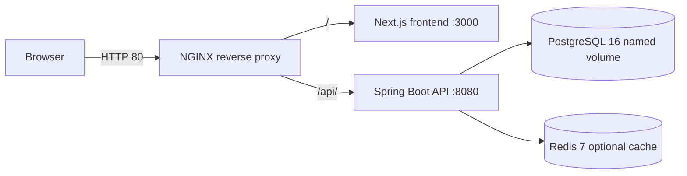
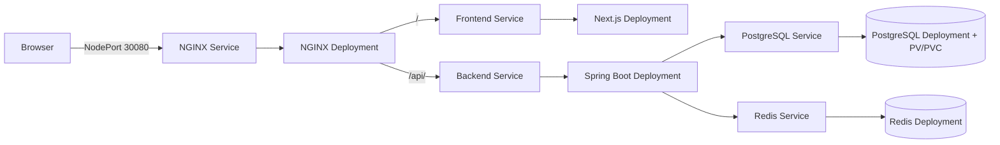

# QT Global DevOps Practical Exam — MyDiary

The exam organizers confirmed that the brief's Go, MongoDB, Valkey, and Vite stack names are a typo. The supplied application in `app/` is MyDiary: Next.js 14, Spring Boot 3.5, PostgreSQL 16, and Redis 7. Its source README contains the application setup and test account details.

## Repository layout

- `iac/` — Terraform configuration for four verified Proxmox VMs.
- `ansible/` — openSUSE Kubernetes automation, clean reset playbook, and cgroup fix.
- `docker/` — Compose deployment and application Dockerfiles.
- `k8s/` — Kubernetes application manifests.
- `app/` — supplied MyDiary source.
- `monitoring/` — VM and application evidence captured during deployment.

## Access and virtual machines

| VM | Role | IP | Size |
| --- | --- | --- | --- |
| `c2-docker-host` | Docker Compose host | `192.168.160.204` | 4 vCPU, 4 GB RAM, 30 GB disk |
| `c2-k8s-master` | Kubernetes control plane | `192.168.160.205` | 4 vCPU, 4 GB RAM, 30 GB disk |
| `c2-k8s-worker-1` | Kubernetes worker | `192.168.160.206` | 4 vCPU, 4 GB RAM, 30 GB disk |
| `c2-k8s-worker-2` | Kubernetes worker | `192.168.160.207` | 4 vCPU, 4 GB RAM, 30 GB disk |

| Deployment | URL |
| --- | --- |
| Docker Compose | `http://192.168.160.204` |
| Kubernetes | `http://192.168.160.205:30080` |

SSH username: `devops`

VM login password / private key: provided with the submission

Passwords, private keys, API tokens, Kubernetes credentials, and the exam document stay outside Git.

## Architecture

### Docker Compose



### Kubernetes



## Infrastructure status

[Terraform instructions](iac/README.md) document the inspected template and verified static VM outputs. All four VMs are in pool `exam-c4` with 4 vCPU, 4 GB RAM, 30 GB disks, and openSUSE Leap 16.0. The Docker host is `.204`; master `.205`; workers `.206` and `.207`. The final Ansible run has all three Kubernetes nodes Ready.

The infrastructure creation process was:

1. Query template VMID 9004 through the Proxmox API and confirm openSUSE Leap 16, cloud-init, guest agent, `vmbr0`, and the 30 GB base disk.
2. Copy `iac/terraform.tfvars.example` to an ignored local variables file and supply the Proxmox token secret and VM password through `TF_VAR_proxmox_api_token_secret` and `TF_VAR_vm_password`.
3. Run `terraform init`, `terraform fmt -check`, `terraform validate`, `terraform plan`, and `terraform apply` from `iac/`.
4. Create the Docker host first through `enabled_vms`, verify SSH and `/etc/os-release`, then enable and apply the remaining three VMs.
5. Verify each VM's hostname, static address, 4 vCPU, 4 GB RAM, and 30 GB disk. `terraform output` records all four addresses without depending on guest-agent DHCP discovery.

## Task 3: Kubernetes with Ansible

Final cluster verification (23 November 2026):

```text
NAME              STATUS   ROLES           AGE   VERSION    INTERNAL-IP       OS-IMAGE             CONTAINER-RUNTIME
c2-k8s-master     Ready    control-plane   77m   v1.31.14   192.168.160.205   openSUSE Leap 16.0   containerd://1.7.33
c2-k8s-worker-1   Ready    <none>           76m   v1.31.14   192.168.160.206   openSUSE Leap 16.0   containerd://1.7.33
c2-k8s-worker-2   Ready    <none>           76m   v1.31.14   192.168.160.207   openSUSE Leap 16.0   containerd://1.7.33
```

The system pods were Running: Flannel 3/3, kube-proxy 3/3, CoreDNS 2/2, etcd, kube-apiserver, controller-manager, and scheduler. The non-zero RESTARTS shown in that snapshot date from the cgroup-driver correction; they were not increasing after the final fix. A temporary three-replica `nettest` with pod anti-affinity scheduled one pod on each node; a cross-node `wget` returned the NGINX HTML page, then the deployment was deleted.

The second idempotence run completed with `changed=0` and `failed=0`:

```text
c2-k8s-master    ok=28 changed=0 unreachable=0 failed=0 skipped=2
c2-k8s-worker-1  ok=21 changed=0 unreachable=0 failed=0 skipped=2
c2-k8s-worker-2  ok=21 changed=0 unreachable=0 failed=0 skipped=2
```

Run from the repository root with the inventory at `ansible/inventory.ini`:

```powershell
$repo=(Resolve-Path .).Path
docker run --rm -e ANSIBLE_HOST_KEY_CHECKING=False -v "${repo}:/workspace" -w /workspace/ansible qt-ansible:exam-c4 sh -lc 'cp /workspace/iac/id_ed25519_exam /tmp/exam_key && chmod 600 /tmp/exam_key && /opt/venv/bin/ansible-playbook -i inventory.ini -e ansible_ssh_private_key_file=/tmp/exam_key site.yml'
```

The root cause was a version-1 `/etc/containerd/config.toml`: editing its text did not change the effective configuration. Comparing `containerd config dump` (`SystemdCgroup = false`) with kubelet's `cgroupDriver: systemd` exposed the mismatch. `site.yml` now regenerates the config when necessary, sets `SystemdCgroup = true`, restarts containerd before kubelet, and asserts the effective value. `ansible/reset.yml` is retained for future rebuilds; it was not run after this final fix.

## Docker Compose deployment

```text
Browser -> NGINX :80 ---- / ------> Next.js :3000
                    \---- /api/ ---> Spring Boot :8080
                                      |-- PostgreSQL :5432 (named volume)
                                      \-- Redis :6379 (optional cache)
```

Application images pushed to Docker Hub (versioned tags only):

| Deployment | Service | Exact image and tag | Verified remote digest |
| --- | --- | --- | --- |
| Compose | Frontend | `benisamuel/mydiary-frontend:exam-c4-v1` | `sha256:e6aa9289d5adb8b61de0ea00c53fbe60784664ec7d6a725138bbadcb967f3a26` |
| Compose | Backend | `benisamuel/mydiary-backend:exam-c4-v1` | `sha256:3504ded2431a1c38213a4ffe5f7a438c091aa1ad215a3b9435974c45f5e1b670` |
| Kubernetes | Frontend | `benisamuel/mydiary-frontend:exam-c4-v1` | `sha256:e6aa9289d5adb8b61de0ea00c53fbe60784664ec7d6a725138bbadcb967f3a26` |
| Kubernetes | Backend | `benisamuel/mydiary-backend:exam-c4-v2` | `sha256:3fac90c426b80d0831db667363e3f435b35868ef5e19bc9f4226c2451a743413` |

`docker/docker-compose.yml` also uses official NGINX 1.27, PostgreSQL 16, and Redis 7 images. Only NGINX publishes a host port. PostgreSQL data is in the `postgres_data` named volume. Redis is a cache, so it needs no persistent volume; the API reads authoritative data from PostgreSQL when Redis is unavailable.

Copy `docker/.env.example` to `docker/.env`, generate independent random values for `POSTGRES_PASSWORD`, `REDIS_PASSWORD`, and `JWT_SECRET` (at least 32 characters), and keep that file out of Git. Environment variables in the shell override `docker/.env`; remove conflicting variables before deployment. On the Docker VM, place `docker/` in `~/qt-mydiary/docker/`, then run:

```bash
cd ~/qt-mydiary/docker
docker compose --env-file .env pull frontend backend
docker compose --env-file .env up -d --no-build
docker compose --env-file .env ps
curl -i http://localhost/api/health
```

The verified external Compose URL is `http://192.168.160.204`; the openSUSE Docker installation and live-host result are documented below.

### Local verification on 2026-11-23

- `docker compose config --quiet`: passed; all five required services resolved.
- Multi-stage frontend and backend builds: passed. The frontend runs the Next.js standalone server, and the backend packages `diary-api.jar` with Java 21.
- `GET /`: HTTP 200. `GET /api/health`: HTTP 200 with `{"status":"ok","database":"up","cache":"up"}`.
- Registered and logged in a new user, created and listed a diary entry, confirmed a USER receives HTTP 403 at `/api/admin/users`, and confirmed the seeded ADMIN can access it.
- Stopped Redis: `/api/health` reported `database=up, cache=down`; login and diary entry creation still worked. Redis was restarted.
- Pulled both application images back from Docker Hub, recreated the full stack with `--no-build`, and confirmed the frontend, health endpoint, and seeded admin login still worked. PostgreSQL retained its data across container recreation.
- Recreated the backend while Redis was stopped. Backend and frontend health checks passed, and `/api/health` reported `database=up, cache=down`. Redis was restored afterward.

These checks ran on the laptop's local Compose stack.

## Task 4: Kubernetes application

The declarative deployment is `k8s/all.yaml` in namespace `qt-go-app`. It uses the versioned Docker Hub images, a local PV/PVC for PostgreSQL, password-protected Redis, resource requests and limits, and liveness/readiness probes. External access is through NGINX NodePort `30080`: `http://192.168.160.205:30080` (the worker addresses `.206` and `.207` also work). CORS explicitly allows all three NodePort origins.

`k8s/secret.example.yaml` contains placeholders only. The live Secret was created on the cluster without committing values:

```bash
kubectl create secret generic mydiary-secrets -n qt-go-app \
  --from-literal=POSTGRES_PASSWORD="$POSTGRES_PASSWORD" \
  --from-literal=REDIS_PASSWORD="$REDIS_PASSWORD" \
  --from-literal=JWT_SECRET="$JWT_SECRET" --dry-run=client -o yaml | kubectl apply -f -
kubectl apply -f k8s/all.yaml
```

Live persistence and cache proof (23 November 2026; response bodies containing JWTs were intentionally omitted):

```text
PROOF_USER=task4-proof-1795440122@qt.rw
REGISTER_HTTP=201
POSTGRES_BEFORE=pod/postgres-56657f6968-xm86t
POSTGRES_AFTER=pod/postgres-56657f6968-bf29w STATUS=Running
LOGIN_AFTER_POSTGRES_RECREATE_HTTP=200
REDIS_DOWN_LOGIN_HTTP=200
REDIS_DOWN_CREATE_ENTRY_HTTP=201
REDIS_DOWN_HEALTH={"status":"ok","database":"up","cache":"down"}
REDIS_RESTORED=1/1
REDIS_RESTORED_HEALTH={"status":"ok","database":"up","cache":"up"}
```

Redis needs no persistent storage because it is only a cache. When Redis is unavailable, the application falls back to PostgreSQL, which remains the authoritative persistent store.

Raw persistence and cache evidence (JWT deliberately redacted):

```text
$ kubectl get pods -n qt-go-app -l app=postgres -o wide
NAME                        READY   STATUS    RESTARTS   AGE     IP            NODE            NOMINATED NODE   READINESS GATES
postgres-56657f6968-bf29w   1/1     Running   0          7m39s   10.244.0.28   c2-k8s-master   <none>           <none>
$ kubectl get pods -n qt-go-app -l app=postgres -o wide
NAME                        READY   STATUS    RESTARTS   AGE   IP            NODE            NOMINATED NODE   READINESS GATES
postgres-56657f6968-8nq72   1/1     Running   0          11s   10.244.0.29   c2-k8s-master   <none>           <none>
$ curl POST /api/auth/login | jq del(.token)
{"token":"<redacted>","expiresIn":86400,"user":{"id":7,"fullName":"Raw Proof User","email":"task4-raw-1795440581@qt.rw","role":"USER","createdAt":"2026-11-23T13:29:41.570664Z"}}
$ curl /api/health
{"status":"ok","database":"up","cache":"down"}
$ curl /api/health
{"status":"ok","database":"up","cache":"up"}
```

### End-to-end verification of both deployments

| Deployment | Health | Register A/B | Login A/B | Create entry | User B reads A | USER admin API | ADMIN login/list | Result |
| --- | --- | --- | --- | --- | --- | --- | --- | --- |
| Compose `192.168.160.204` | 200, DB/cache up | 201/201 | 200/200 | 201 | 404 | 403 | 200/200 | PASS |
| Kubernetes `192.168.160.205:30080` | 200, DB/cache up | 201/201 | 200/200 | 201 | 404 | 403 | 200/200 | PASS |

An ownership lookup returning HTTP 404 confirms user B cannot discover or read user A's diary entry. The USER receives HTTP 403 from `/api/admin/users`, while `admin@qt.rw` logs in and lists users with HTTP 200.

The optional chart in `k8s/helm/mydiary` is **not verified and not deployed**, so this submission does not claim the Helm bonus.

### Docker VM deployment

On `c2-docker-host` (`192.168.160.204`), openSUSE Leap 16.0 installed Docker 29.7.2 and Compose 2.33.1 from the `docker` and `docker-compose` zypper packages. Docker is enabled, and `devops` is in the `docker` group. The VM pulled the versioned images from Docker Hub and started all five services. Because SELinux is enforcing on this host, the NGINX bind mount uses the `:Z` relabel option. External verification returned HTTP 200 for `http://192.168.160.204/` and `{"status":"ok","database":"up","cache":"up"}` from `/api/health`.

## Task 5 monitoring screenshots

Commands are documented in `monitoring/commands.sh` and `monitoring/README.md`. Each command clears the terminal and prints the real hostname before the monitored output. Update each status after capturing the image on the indicated VM.

| Screenshot file | What the captured image shows |
| --- | --- |
| `monitoring/vm1-top.png` | Docker host CPU, memory, load averages, and top processes. |
| `monitoring/vm1-df.png` | Docker host filesystem capacity and usage. |
| `monitoring/vm1-free.png` | Docker host total, used, free, and available memory. |
| `monitoring/vm1-uptime.png` | Docker host uptime and 1/5/15-minute load averages. |
| `monitoring/vm1-ss.png` | Docker host listening ports and services. |
| `monitoring/vm1-ps.png` | Docker host processes sorted by CPU usage. |
| `monitoring/vm2-top.png` | Control-plane CPU, memory, load averages, and top processes. |
| `monitoring/vm2-df.png` | Control-plane filesystem capacity and usage. |
| `monitoring/vm2-free.png` | Control-plane total, used, free, and available memory. |
| `monitoring/vm2-uptime.png` | Control-plane uptime and load averages. |
| `monitoring/vm2-ss.png` | Control-plane listening ports and Kubernetes services. |
| `monitoring/vm2-ps.png` | Control-plane processes sorted by CPU usage. |
| `monitoring/vm3-top.png` | Worker 1 CPU, memory, load averages, and top processes. |
| `monitoring/vm3-df.png` | Worker 1 filesystem capacity and usage. |
| `monitoring/vm3-free.png` | Worker 1 total, used, free, and available memory. |
| `monitoring/vm3-uptime.png` | Worker 1 uptime and load averages. |
| `monitoring/vm3-ss.png` | Worker 1 listening ports and Kubernetes services. |
| `monitoring/vm3-ps.png` | Worker 1 processes sorted by CPU usage. |
| `monitoring/vm4-top.png` | Worker 2 CPU, memory, load averages, and top processes. |
| `monitoring/vm4-df.png` | Worker 2 filesystem capacity and usage. |
| `monitoring/vm4-free.png` | Worker 2 total, used, free, and available memory. |
| `monitoring/vm4-uptime.png` | Worker 2 uptime and load averages. |
| `monitoring/vm4-ss.png` | Worker 2 listening ports and Kubernetes services. |
| `monitoring/vm4-ps.png` | Worker 2 processes sorted by CPU usage. |
| `monitoring/docker-ps.png` | Running Compose containers, ports, images, and health status. |
| `monitoring/docker-stats.png` | Per-container CPU, memory, network I/O, and process counts. |
| `monitoring/docker-volumes.png` | Docker images, containers, and PostgreSQL volume disk usage. |
| `monitoring/valkey-cache.png` | Authenticated Redis cached keys, memory use, keyspace hits, and keyspace misses on `c2-docker-host`. |
| `monitoring/vm1-health.png` | Compose health JSON showing database and cache state. |
| `monitoring/k8s-nodes.png` | Kubernetes node readiness, roles, addresses, and runtimes. |
| `monitoring/k8s-pods.png` | Pod status, readiness, restarts, IPs, and node placement. |
| `monitoring/k8s-health.png` | Kubernetes health JSON showing database and cache state. |
